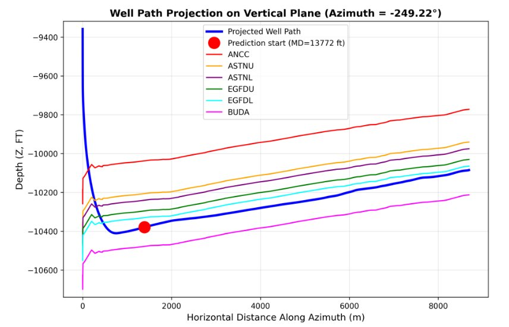
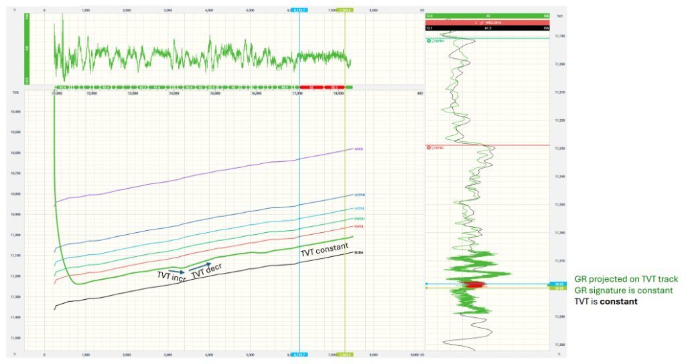
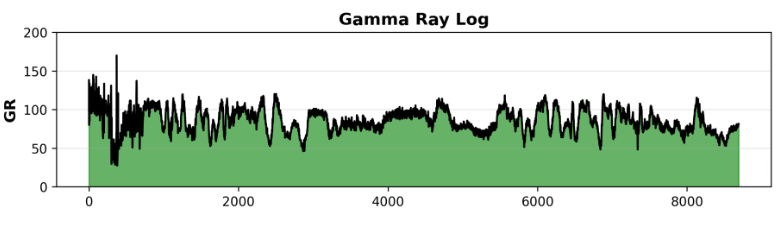
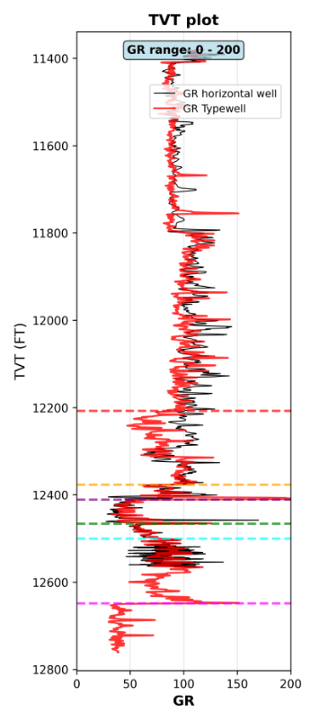
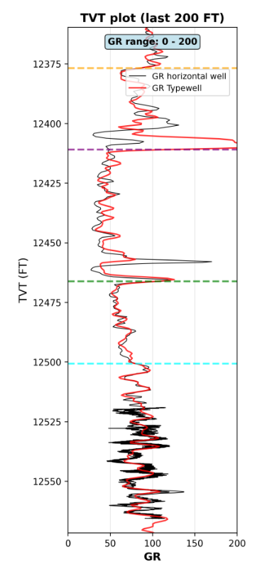

# Proyecto final Reconocimiento de Patrones 2026-2

Predicción de `TVT` (profundidad vertical verdadera) en pozos horizontales, usando los datos de la competencia de Kaggle [ROGII: Wellbore Geology Prediction](https://www.kaggle.com/competitions/rogii-wellbore-geology-prediction).

---

## 1. El problema

### ¿Qué se predice?

Se predice el **TVT** (*True Vertical Thickness*), medido en pies, para cada pie de la parte horizontal de un pozo. El TVT indica **en qué posición dentro de las capas de roca está la barrena en cada momento**. Para saberlo se usa como mapa un pozo vertical de referencia (*typewell*): cada profundidad de ese pozo vertical corresponde a un valor de TVT.

Aunque el pozo avance casi en línea recta, las capas de roca suelen estar inclinadas o dobladas:
- Si el pozo entra hacia **capas más profundas** (más abajo en el mapa geológico), el **TVT aumenta**.
- Si el pozo sube hacia **capas más someras** (más arriba en el mapa geológico), el **TVT disminuye**.
- Si el pozo logra navegar **paralelo dentro de la misma capa**, el **TVT se mantiene casi constante**.

En los datos de entrenamiento, el TVT lo marcó un geólogo comparando la radiactividad natural de la roca (rayos gamma, `GR`) medida en el pozo horizontal contra la del pozo de referencia, ya que cada capa tiene una firma característica. En cada pozo conocemos el TVT hasta cierto punto llamado **Prediction Start (PS)** (columna `TVT_input`); a partir de ahí está vacío (`NaN`) y debemos predecirlo pie por pie.

En resumen, se trata de **continuar el trabajo del geólogo** usando la trayectoria del pozo (`MD`, `X`, `Y`, `Z`), sus rayos gamma y el pozo de referencia.

<p align="center">
  
</p>
<p align="center"><em>Ejemplo de un pozo horizontal atravesando capas de roca inclinadas (líneas de colores). El punto rojo marca el Prediction Start (PS): antes conocemos el TVT; después hay que predecirlo.</em></p>

<p align="center">
  
</p>
<p align="center"><em>Cómo cambia el TVT según hacia dónde se mueva la barrena respecto a las capas: aumenta al bajar hacia capas más profundas (<code>TVT incr</code>), disminuye al subir (<code>TVT decr</code>) y permanece estable si el pozo sigue paralelo a la capa (<code>TVT constant</code>).</em></p>

### ¿Con qué datos?

Los datos son mediciones de pozos petroleros horizontales. Cada pozo tiene un identificador único de 8 caracteres (por ejemplo, `015fe0d2`) y viene con dos archivos CSV:

- **Pozo horizontal** (`{WELLNAME}__horizontal_well.csv`): un renglón por cada pie perforado, con:
  - `MD`: distancia medida desde la superficie hasta ese punto (en pies).
  - `X`, `Y`, `Z`: coordenadas bajo tierra (`Z` es la profundidad bajo el nivel del mar; valores más negativos son más profundos).
  - `GR`: rayos gamma (radiactividad natural de la roca). Contiene valores faltantes (`NaN`).
  - `TVT_input`: el TVT conocido hasta el *Prediction Start*; después viene vacío (`NaN`).
  - `TVT`: la respuesta real que hay que predecir (**solo en entrenamiento**).
- **Pozo de referencia o *typewell*** (`{WELLNAME}__typewell.csv`): pozo vertical cercano que sirve como mapa de las capas, con:
  - `TVT`: profundidad de referencia en el pozo vertical.
  - `GR`: firma de rayos gamma a esa profundidad.
  - `Geology`: nombre de la formación geológica (**solo en entrenamiento**).

Los archivos están separados en dos carpetas:
- **`train/`**: 773 pozos completos para entrenar. Además incluyen la profundidad de seis capas (`ANCC`, `ASTNU`, `ASTNL`, `EGFDU`, `EGFDL`, `BUDA`) y una imagen `.png` de referencia que **no** están disponibles al predecir en prueba.
- **`test/`**: en Kaggle contiene ~200 pozos ocultos sin `TVT` después del PS. La carpeta `test/` descargada localmente solo trae **3 pozos de ejemplo** para probar el formato de envío.

Todas las distancias están en **pies** y los rayos gamma (`GR`) en unidades **API**.

<p align="center">
  
</p>
<p align="center"><em>Registro de rayos gamma (<code>GR</code>) medido a lo largo de un pozo horizontal.</em></p>

<p align="center">
  
  &nbsp;&nbsp;&nbsp;
  
</p>
<p align="center"><em>Alineación del <code>GR</code> del pozo horizontal (negro) con el <code>GR</code> del pozo de referencia (rojo) sobre el eje de <code>TVT</code>: vista completa (izquierda) y acercamiento a los últimos 200 pies (derecha).</em></p>

### ¿Con qué métrica y por qué tiene sentido?

La competencia evalúa con el **RMSE** (*root mean squared error*, raíz del error cuadrático medio):

$$
\text{RMSE} = \sqrt{\frac{1}{n} \sum_{i=1}^{n} (y_i - \hat{y}_i)^2}
$$

Para cada pie en la zona de evaluación se calcula la diferencia entre el TVT real ($y_i$) y el predicho ($\hat{y}_i$), se eleva al cuadrado, se promedia sobre **todos los puntos de todos los pozos de prueba juntos** y se saca la raíz.

Esta métrica tiene sentido para el problema porque:
- **El TVT es continuo y se interpreta en pies:** un RMSE de 5 significa que, a grandes rasgos, nos equivocamos por unos 5 pies al ubicar la barrena dentro de las capas.
- **Castiga fuerte los errores grandes:** equivocarse por 20 pies pesa mucho más que equivocarse varias veces por 2 pies. En perforación real, una desviación pequeña es tolerable, pero confundir una capa con otra puede sacar el pozo de la zona productiva.
- **Penaliza la deriva acumulada:** como se predice pie a pie desde el último TVT conocido, un error temprano que crece a lo largo de miles de pies dispara el RMSE.

---

## 2. Los datos

La exploración completa (código, tablas y gráficas) se encuentra en [`libretas/01-exploracion.ipynb`](libretas/01-exploracion.ipynb). Los hallazgos principales que definieron nuestras decisiones de validación, línea base y atributos fueron:

* **Diferencias entre entrenamiento y prueba:**
  * Los **3 pozos en `test/` local** (`000d7d20`, `00bbac68`, `00e12e8b`) son copias tomadas del propio `train/` para verificar el formato de envío; los ~200 pozos reales de prueba están ocultos en Kaggle. Por eso no se usa `test/` local para validar ni sacar estadísticas.
  * Las 6 cimas de formaciones (`ANCC`, `ASTNU`, `ASTNL`, `EGFDU`, `EGFDL`, `BUDA`) y la columna `Geology` del `typewell` **no existen en prueba**, así que no pueden usarse como variables de entrada.
  * Las coordenadas (`MD`, `X`, `Y`, `Z`) y el `typewell` (`TVT`, `GR`) están **100 % completos** (0 % faltantes).

* **Estructura por grupos, secuencia y desbalance en el RMSE:**
  * Hay **773 pozos** en entrenamiento (5,092,255 filas en total). En el 100 % de los pozos, `MD` avanza exactamente de **1 en 1 pie**, el corte *Prediction Start* (PS) es limpio (todo conocido primero, todo vacío después) y `TVT_input` coincide exactamente con `TVT` antes de PS.
  * Aunque el tramo conocido es parecido entre pozos (mediana ~1,703 pies), la zona a predecir va de **407 a 10,052 pies** (~25× de diferencia). Como el RMSE promedia sobre puntos y no sobre pozos, **el 10 % de pozos más largos concentra el 14.9 % de todos los puntos a predecir**.
  * *Decisión:* validar siempre **separando por pozo completo** (nunca mezclando filas de un mismo pozo) y calcular el RMSE concatenando todos los puntos de evaluación, igual que Kaggle.

* **Valores faltantes en `GR`:**
  * Falta el **29.6 %** de `GR` en entrenamiento (23.6 % antes de PS y 31.5 % después de PS), y **188 pozos (24.3 %)** tienen más del 50 % vacío en la zona de evaluación (aunque ninguno está 100 % vacío).
  * Sin embargo, al revisar la duración de cada hueco consecutivo, el **61.6 % mide solo 1 pie** y el **95.7 % mide 5 pies o menos** (81.1 % de todos los `NaN`). Es decir, en su gran mayoría son pausas cortas entre lecturas y no fallas prolongadas.
  * *Decisión:* interpolar `GR` únicamente en huecos cortos, añadir una columna indicadora (`GR_isna`) y no depender solo de `GR`, combinándolo con geometría y pozos vecinos.

* **Distribuciones y referencia geométrica:**
  * `GR` no tiene valores negativos y casi no presenta valores extremos (99 % debajo de 155 API en pozos horizontales; solo 11 filas > 300 API en 3.58 millones de lecturas).
  * Comparando dos predicciones triviales en toda la zona de evaluación: asumir capas planas siguiendo la profundidad (`TVT_PS - ΔZ`) da un RMSE global de **107.49 pies**, mientras que mantener **`TVT` constante** igual al último valor conocido en PS logra **15.91 pies** (el rango mediano de `TVT` en ~4,840 pies de recorrido es de apenas 26.4 pies, porque el perforador intenta seguir la misma capa inclinada).
  * *Decisión:* predecir el cambio relativo ($\Delta\text{TVT} = \text{TVT} - \text{TVT}_{\text{PS}}$) y tomar **15.91 pies** como piso mínimo de referencia.

* **Estructura espacial y dirección de perforación (azimut):**
  * El **90 % de los pozos** están perforados en dos direcciones opuestas: **Noroeste** (51.4 %, pendiente aparente media de **+3.54 pies / 100 pies**) y **Sureste** (38.6 %, pendiente media de **-3.26 pies / 100 pies**), con marcada coherencia geográfica en el mapa `(X, Y)`.
  * *Decisión:* incluir atributos de dirección (`dX`, `dY`, `dZ`, azimut) e inclinación de **pozos vecinos** (*offset wells*), calculada siempre solo con los pozos de entrenamiento de cada *fold* (*out-of-fold*) para evitar fugas.

* **Correspondencia con el *typewell*:**
  * Antes de PS, el `GR` horizontal correlaciona bien con el `GR` del `typewell` (mediana de **0.81**), pero con desfases de calibración entre pozos (diferencia media de hasta ±15 API).
  * *Decisión:* normalizar/calibrar `GR` por pozo usando la zona conocida antes de PS y aprovechar tanto la correlación con el `typewell` como con el propio tramo previo a PS.

### Resumen: hallazgos y decisiones

| Hallazgo en la exploración | Decisión para validación, línea base o atributos |
| :--- | :--- |
| `test/` local son 3 pozos repetidos de `train/`; `Geology` y `ANCC..BUDA` no están en prueba. | No validar con `test/` local ni usar `Geology` o las cimas como entradas. |
| Pozos independientes, paso exacto de 1 pie y corte PS 100 % limpio. | Validación cruzada **agrupada por pozo** evaluada solo en `TVT_input.isna()`. |
| El 10 % de pozos más largos aporta 14.9 % del peso en el RMSE. | Medir RMSE concatenando todos los puntos de evaluación y monitorear también el RMSE por pozo. |
| 95.7 % de los huecos de `GR` miden ≤ 5 pies, pero 24.3 % de pozos tienen > 50 % faltante. | Interpolar huecos cortos de `GR`, conservar bandera `GR_isna` y combinar con geometría. |
| `TVT` constante = 15.91 ft de RMSE vs capas planas = 107.49 ft. | Predecir $\Delta\text{TVT}$ respecto a `TVT_PS` y usar 15.91 ft como referencia mínima. |
| 90 % de pozos van al NW (+3.5 ft/100 ft) o SE (-3.3 ft/100 ft) con coherencia espacial. | Usar trayectoria/azimut y pendiente de pozos vecinos calculada *out-of-fold*. |
| Correlación mediana de 0.81 entre `GR` horizontal y `typewell`, con sesgos de hasta ±15 API. | Calibrar/normalizar `GR` por pozo usando la sección conocida antes de PS. |

---

<details>
<summary><strong>Detalles del proyecto e instalación</strong></summary>

## Estructura

```
proyecto/
├── README.md            # el reporte del proyecto (ver abajo)
├── requirements.txt       # dependencias
├── datos/descargar.py   # descarga los datos con la API de Kaggle
├── libretas/
│   ├── 01-exploracion.ipynb
│   ├── 02-validacion-y-linea-base.ipynb
│   ├── 03-modelos.ipynb
│   └── 04-envio-final.ipynb
├── src/                 # funciones reutilizables (atributos, validación, modelos)
├── experimentos.csv     # bitácora: un renglón por experimento
└── leaderboard/         # capturas de la tabla y de envíos
```

## Requisitos

- Python 3.14 (el entorno del proyecto se creó con esta versión)
- Git
- Una cuenta de Kaggle

## Instalación

1. Clona el repositorio y entra a la carpeta:

   ```bash
   git clone <URL-del-repositorio>
   cd recon-patrones-26-2-proyecto
   ```

2. Crea y activa un entorno virtual:

   ```bash
   python -m venv .venv
   ```

   - Windows (PowerShell): `.venv\Scripts\Activate.ps1`
   - Windows (Git Bash): `source .venv/Scripts/activate`
   - macOS / Linux: `source .venv/bin/activate`

3. Instala las dependencias:

   ```bash
   pip install -r requirements.txt
   ```

## Credenciales de Kaggle

Los datos se descargan con `kagglehub`, que necesita credenciales.

1. Entra a la [página de la competencia](https://www.kaggle.com/competitions/rogii-wellbore-geology-prediction) y acepta las reglas (*Join Competition*). Sin esto la descarga falla con error 403.
2. En Kaggle ve a *Settings → API* y genera un token.
3. Copia la plantilla y llénala:

   ```bash
   cp .env.example .env      # en PowerShell: Copy-Item .env.example .env
   ```

## Descarga de datos (manual)

La libreta descarga los datos automáticamente la primera vez. Para hacerlo antes:

```bash
python datos/descargar.py
```

Los archivos quedan en la caché de `kagglehub` (`~/.cache/kagglehub`), fuera del repositorio. El script imprime la ruta.

## Ejecutar las libretas

### Desde un IDE

**VS Code**
1. Instala las extensiones *Python* y *Jupyter*.
2. Abre la carpeta del proyecto y luego `libretas/01-exploracion.ipynb`.
3. Arriba a la derecha pulsa *Select Kernel → Python Environments* y elige `.venv`.
4. Pulsa *Run All* o ejecuta celda por celda con `Shift+Enter`.

**PyCharm**
1. Abre la carpeta y configura el intérprete: *Settings → Python Interpreter → Add → Existing* y elige `.venv`.
2. Abre la libreta y ejecuta las celdas.

### Desde el navegador

Con el entorno activado, instala JupyterLab (no está en `requirements.txt`) y ábrelo desde la raíz del proyecto:

```bash
pip install jupyterlab
jupyter lab
```

Se abrirá el navegador (o copia la URL con el token que aparece en la terminal). Abre `libretas/01-exploracion.ipynb`. Si te pide kernel, elige *Python 3*.

> Tip: si `.venv` no aparece como kernel, regístralo con
> `python -m ipykernel install --user --name recon-patrones`.

## Problemas comunes

- **403 / Forbidden al descargar**: no aceptaste las reglas de la competencia, o el usuario/token en `.env` son incorrectos.
- **`ModuleNotFoundError`**: el kernel no es el de `.venv`; selecciónalo de nuevo.
- **Credenciales no encontradas**: verifica que `.env` exista en la raíz del proyecto y tenga ambos valores.
</details>